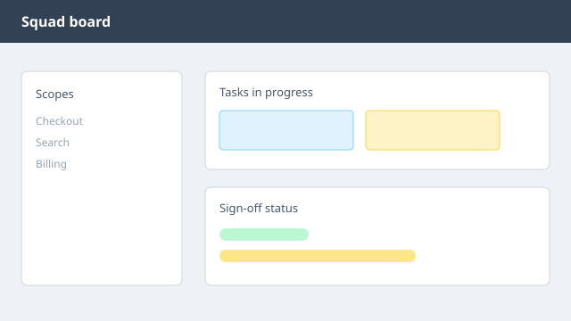

# Rich features sample: markers, pins, diff, compare, tags

:::tip{title="What this page shows" #answer}
Every rich feature of the viewer on one page, each with a real example. Marked-up code and image first (the numbered-marker primitive), then diff, comparison, a long sequence, layout, and a tour of the older components.
:::

## 1. Marked-up code: numbered markers with margin notes

A fence takes `start=` for a real line-number gutter and `marks="line:n …"` for badges. `{…}` keeps its old job (a neutral "look here" band); marks and highlights count lines **within the block**, while the gutter shows the real file lines. Hover or click a badge, a note, or an underlined phrase to light its partners. :tag[verified]{src="src/core/fence.ts:118-138"}

:::annotated
```ts start=118 {9-10} marks="7:1 15:2 16:3" title="src/core/fence.ts"
function wrapHighlightedLines(
  highlighted: string,
  hlLines: Set<number>,
  marks: Map<number, string>,
  numbered: boolean,
): string {
  if (hlLines.size === 0 && marks.size === 0 && !numbered) return highlighted

  const lines = highlighted.split('\n')
  if (lines.at(-1) === '') lines.pop()

  return lines
    .map((line, idx) => {
      const n = idx + 1
      const mk = marks.get(n)
      const cls = (hlLines.has(n) ? 'hl' : 'code-line') + (mk ? ' mk' : '')
      const mkAttr = mk ? ` data-mk="${mk}"` : ''
      return `<span class="${cls}"${mkAttr}>${line}</span>`
    })
    .join('')
}
```

A fence with no highlight, no marks and no gutter must come back :marker[untouched]{n=1}, or every plain block would pay for line wrapping.

:::marker{n=1 title="Early return keeps plain blocks plain"}
The guard is the reason existing documents render byte-for-byte as before.
:::
:::marker{n=2 title="Lookup by 1-based line"}
`idx + 1` is the same numbering as `{…}` and `marks`, so the three never disagree.
:::
:::marker{n=3}
The `mk` class is added next to `hl` / `code-line`, so a line can be both highlighted and marked.
:::
:::

:::columns{count=2}
:::col
### Notes sit level with their marker
On a container 760px or wider, each note is moved to the height of the line it explains and pushed down just enough not to overlap the note above.
:::
:::col
### Below that they stack
Narrow screens put the notes under the material. The badges keep the link, so hover still works.
:::
:::

## 2. Marked-up image: numbered pins

`:::pins` wraps an image; `::pin` positions in **percent of the image**, so a pin stays on the same pixel at any rendered width. `x`/`y` alone is a point; add `w`/`h` for an outlined region. :tag[inferred]{src="docs/rich-features-sample-shot.svg"}

:::annotated
:::pins

::pin{x=94 y=6.5 n=1 label="Header"}
::pin{x=3.5 y=22 w=28.5 h=67 n=2 label="Scope list"}
::pin{x=36 y=58 w=60.5 h=31 n=3 label="Sign-off"}
:::

:::marker{n=1 title="Header"}
Names the board. Nothing to act on.
:::
:::marker{n=2 title="Scope list"}
Pick a scope here; the two panels follow it.
:::
:::marker{n=3 title="Sign-off panel"}
Amber bars are sign-offs still waiting. This is the panel to read before approving.
:::
:::

## 3. Truth tags: what is verified, inferred, or unknown

`:tag[label]{src="file:line"}` marks how sure a claim is and points at the source. Known labels pick their own colour; the `src` text copies on click.

| Claim | Status |
|---|---|
| Fence parses `start=` and `marks=` | :tag[verified]{src="src/core/fence.ts:43"} |
| Notes align on wide containers | :tag[verified]{src="src/core/markers.ts:101"} |
| Step position survives a preview re-render | :tag[inferred]{src="src/core/hydrate.ts:26"} |
| Works in the real VS Code preview | :tag[not verified] |
| An old behaviour that regressed | :tag[failed] |
| Any label, any colour | :tag[custom]{color=info} |

## 4. Code diff

A `diff` fence renders a unified diff. Paste `git diff` output as-is: added and removed rows are tinted, `@@` hunks drive an old/new line-number gutter, and `lang=ts` highlights the code under the signs. Copying a selection gives plain code, without signs or numbers. :tag[verified]{src="src/core/diff.ts:1"}

```diff lang=ts title="src/core/fence.ts"
diff --git a/src/core/fence.ts b/src/core/fence.ts
--- a/src/core/fence.ts
+++ b/src/core/fence.ts
@@ -158,6 +158,7 @@ function wrapHighlightedLines(
     .map((line, idx) => {
       const n = idx + 1
-      const cls = hlLines.has(n) ? 'hl' : 'code-line'
+      const mk = marks.get(n)
+      const cls = (hlLines.has(n) ? 'hl' : 'ln-row') + (mk ? ' mk' : '')
       return `<span class="${cls}">${line}</span>`
     })
     .join('')
```

A bare `+`/`-` snippet needs no headers, and a diff takes `marks` like any fence:

:::annotated
```diff lang=ts marks="3:1"
-  return token
+  const token = sign(user)
+  return token
```

:::marker{n=1 title="Sign before returning"}
The new line is the whole fix; the return is unchanged context moved down.
:::
:::

## 5. Before / after

`:::compare` shows both sides at once. It is not `:::revision`, which hides the old text behind a gutter marker.

:::compare
:::before{title="Before: described in prose"}
> "The second note should be near the line about the redirect, roughly in the lower half."

The reader scans the code to find which line is meant.
:::
:::after{title="After: a marker on the line"}
Line 4 carries a :marker[numbered badge]{n=2}, and the note with the same number sits beside it.

The reader never maps a description back to the source.
:::
:::

## 6. Long sequence: numbered steps

`:::steps` numbers a process and joins the steps with a connector line. Each body is a full document, so a step can hold code, tables or a nested callout.

:::steps
:::step{title="Parse"}
`parseBlocks` turns the source into an AST of text and directive nodes, treating fenced code as opaque. :tag[verified]{src="src/core/parser.ts:181"}
:::
:::step{title="Claim the block"}
The `em_directive` block rule matches `:::name` / `::name` lines and emits one token carrying the raw text and its source map. :tag[verified]{src="src/markdownItPlugin.ts:198"}
:::
:::step{title="Look up the spec"}
The registry maps each name to its renderer. An unknown name falls back to a visible labelled box rather than vanishing.
:::
:::step{title="Render children"}
Text runs go through a private markdown-it (never the outer one, which would re-enter the block rule); nested directives recurse.
:::
:::step{title="Fences"}
Code blocks render server-side with highlight.js, line wrappers, gutter numbers and marker badges. :tag[verified]{src="src/core/fence.ts:153"}
:::
:::step{title="Stamp for scroll sync"}
The token's line map reaches a `data-line` wrapper so the preview and the editor scroll together.
:::
:::step{title="Hydrate"}
Tabs, accordions, step positions and copy buttons are wired once by delegation and restored from module-level state.
:::
:::step{title="Set up markers"}
`setupMarkers` aligns notes and re-lights a pinned marker after every render. :tag[verified]{src="src/core/markers.ts:29"}
:::
:::step{title="Morphdom wipes, the runtime restores"}
VS Code re-derives the DOM from source on each edit, so everything above that is client-side state runs again.
:::
:::

## 7. Layout: auto-fit and sticky columns

`min=` turns `:::columns` into auto-fit: as many columns as fit, each at least that wide. `{sticky}` keeps a short column in view while its taller neighbour scrolls. Scroll this section to see the left column stay put.

:::columns{min=300px gap=lg}
:::col{sticky}
:::card{title="Reading guide" icon=menu_book}
Stays pinned while the long column scrolls.

- :chip[Marker]{primary} number links code ↔ note
- :chip[Pin]{info} point or region on an image
- :chip[Tag]{success} verified / inferred / unknown
:::
:::
:::col
### A long column

The pinned column to the left is shorter than this one. Without `sticky` it would scroll away with the page and leave blank space under it.

**Why this layout matters for a visual answer.** The short thing a reader keeps consulting (a legend, a table of contents, a diagram) stays visible while the long thing they are actually reading moves.

Below 768px the columns stack in reading order and the pin is released, so nothing covers the text on a phone.

A second paragraph of filler so the column is clearly taller than its neighbour. Markers, pins, tags and diffs all work inside columns, cards and tabs, because each is an ordinary directive that renders children.

A third paragraph. The auto-fit grid recomputes the number of columns as the window resizes, with no breakpoint to maintain.

A fourth paragraph, to give the sticky column something to travel beside.

A fifth paragraph. Keep scrolling.

A sixth paragraph. Nearly there.
:::
:::

## 8. Marked-up code inside tabs

Notes align after the tab opens, because the layout re-measures when a hidden panel gets a real size.

:::tabs
:::tab{title="Align loop"}
:::annotated
```ts start=116 marks="3:1 8:2 9:3 14:4" title="src/core/markers.ts"
  annot.setAttribute('data-aligned', '')
  // Measured against the notes column, so scroll position and layout offsets cancel out.
  const colTop = notes.getBoundingClientRect().top
  let cursor = 0
  items.forEach(note => {
    const n = note.dataset.mk
    const anchor = n ? main.querySelector<HTMLElement>(`[data-mk="${n}"]`) : null
    const want = anchor ? anchor.getBoundingClientRect().top - colTop : cursor
    const top = Math.max(want, cursor)
    note.style.top = `${top}px`
    cursor = top + note.offsetHeight + NOTE_GAP
  })
  // Absolutely-positioned notes no longer size their column; keep the block tall enough.
  notes.style.minHeight = `${Math.max(0, cursor - NOTE_GAP)}px`
```

:::marker{n=1 title="Column-relative"}
Measuring against the notes column cancels scroll position.
:::
:::marker{n=2 title="Where the marker is"}
Falls back to the running cursor when a note has no matching badge.
:::
:::marker{n=3 title="Never overlap"}
`Math.max(want, cursor)` pushes a note down past the one above.
:::
:::marker{n=4}
Absolute notes stop sizing their column, so the height is set by hand.
:::
:::
:::
:::tab{title="Plain"}
The same fence without `marks` or `start` renders exactly as before.

```ts title="plain.ts" {2}
const a = 1
const b = 2
```
:::
:::

## 9. A diagram with linked detail

`:::explorer` pins the diagram; clicking a box scrolls to its section. `:::legend` explains the colours.

:::explorer
:::legend
::legend-item{color=primary label="Source"}
::legend-item{color=info label="Engine"}
::legend-item{color=success label="Output"}
```mermaid
graph LR
  src["Markdown source"]:::primary --> parse["Parser"]:::info
  parse --> render["Renderer"]:::info
  render --> html["HTML"]:::success
  classDef primary fill:var(--c-primary-bg),stroke:var(--c-primary),color:var(--c-primary-text)
  classDef info fill:var(--c-info-bg),stroke:var(--c-info),color:var(--c-info-text)
  classDef success fill:var(--c-success-bg),stroke:var(--c-success),color:var(--c-success-text)
```
:::

### Markdown source {#src}
Plain text with `:::`, `::` and `:` directives; fences are opaque.

### Parser {#parse}
`parseBlocks` classifies lines into text and directive nodes. :tag[verified]{src="src/core/parser.ts:181"}

### Renderer {#render}
Walks the AST and asks the registry for each directive's HTML.

### HTML {#html}
What the preview and the exported file both show.
:::

## 10. The older components, in one place

:::cards{cols=3}
:::card{title="Card" icon=dashboard}
A titled tile, here in a 3-column grid.
:::
:::card{title="Callout types" icon=campaign}
note, tip, info, warning, danger, success.
:::
:::card{title="Timeline" icon=timeline}
Dated events with icons.
:::
:::

:::note{title="Note"}
A neutral aside.
:::
:::warning{title="Warning"}
Something to watch.
:::
:::danger{title="Danger"}
Something that breaks.
:::
:::success{title="Success"}
Something that passed.
:::

:::accordion
:::details{title="First detail" open}
Opening another closes this one.
:::
:::details{title="Second detail"}
Hidden until opened.
:::
:::

:::timeline
:::event{date="2026-07" icon=rocket color=primary}
**Explorer** pins a diagram beside its detail.
:::
:::event{date="2026-09" icon=present_to_all color=info}
**Present mode** narrates a document.
:::
:::event{date="2026-10" icon=push_pin color=success}
**Markers, pins, diff, compare, tags** (this page).
:::
:::

::progress{value=80 max=100 color=success label="Rich-feature coverage"}

:::revision{note="Raised the limit" date="2026-10-20"}
The API accepts up to 500 requests per minute.

:::previous
The API accepts up to 1000 requests per minute.
:::
:::

Inline: :chip[Active]{success} :chip[Beta]{color=warning variant=outline} :icon[home] :kbd[Ctrl+K] :tooltip[hover me]{tip="A tooltip"} :rating{value=4 max=5} :color[critical]{danger} ==highlighted==

Review notes: :comment[Is 760px the right breakpoint?]{author="Chieu" date="2026-10-20"} :ai[Check the sticky column inside a tab next time]

- [x] Marker primitive
- [x] Pins
- [ ] Verify in the real VS Code preview

```
Reader:     maintainer → decide what to polish next
Question:   What can blueprint-markdown express today, concretely?
Dimension:  Structure
Form:       one sample page, each feature in place, not a feature list: seeing it render is the proof
```
