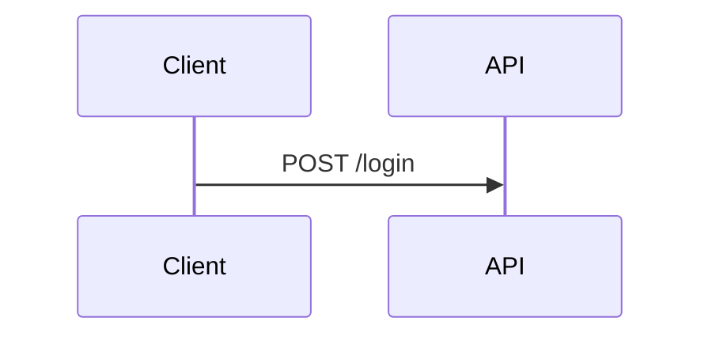

# Blueprint answer

A decision procedure, not a component catalog. You pick the form; these steps make the pick deliberate.
Output is one blueprint-markdown file. Load `blueprint-markdown` for syntax; do not restate it here.
Craft skills: `blueprint-markdown` (components), `mermaid-diagrams` (diagrams, `:::explorer`),
`evidence` (screenshots, proof), `present` (narrated).

## Level: set by the user's words

| User says | Level | Output |
|---|---|---|
| "sketch", "quick visual" | **sketch** | One visual answering one question. Steps 1–4, 6–9, 11. |
| "visualize", "explain visually", "show me" | **explain** | A layered doc. All steps. |
| "present", "walkthrough" | **present** | Run all steps, then hand the content to the `present` skill. |

## Steps

### 1. Reader and action
Name the reader (user, dev reviewers, BA/PM, or a mix) and the action after reading: approve, debug,
decide, sign off, learn. When no action exists, answer in chat text instead.

### 2. One question
Write the single question the doc answers, in one sentence; a second question gets its own visual.

### 3. Main dimension
Pick the one dimension that dominates the content. The form follows from it.

| Dimension | Question it answers | Forms that fit | Losing candidate (why it loses) |
|---|---|---|---|
| **Time** | What happens first, next, last? | `sequenceDiagram`, swimlane, `:::steps`, `:::timeline` | box graph: hides the order |
| **Structure** | What connects to what? | mermaid graph, ER diagram, nested containment, `:::explorer` | list: hides the links; one giant graph: group it |
| **State** | Which states exist, what moves between them? | `stateDiagram` with named transitions, status lane | flowchart: mixes actions with states |
| **Comparison** | Which option, and why? | recommendation, then criteria × options table, `:::compare`, `:::cards` | prose per option: the reader builds the table |
| **Quantity** | How much, what trend? | bar (compare), line (trend), `::progress`, one big number | number table for a trend; many-slice pie |
| **Space** | Where on screen? | `:::annotated` screenshot with `::pin`s, wireframe | describing positions in words |
| **Change** | What is different? | ` ```diff `, `:::compare`, `:::revision` | the new state alone: the reader recalls the old |
| **Cause** | Why did it happen? | causal chain, `:::timeline` with the fault point marked | raw event log with no fault marked |

Name exactly one; a second strong dimension becomes a second visual.

### 4. Reject an alternative
List at least two candidate forms, pick one, give the reason in one line ("timeline, not graph: the bug is
about ordering"). Read `taste.md` first; loved forms tip close calls. When the output goes to other people
(team, BA), show the user the candidates one line each and let them pick before building.

### 5. Layer by depth
Stack three **depths**, so each reader stops when they have enough:
- **Meaning**: what it means in plain words. The BA/PM stops here.
- **Mechanism**: how it works. The reviewer stops here.
- **Evidence**: `file:line`, queries, test output, screenshots. The user reads this.

Meaning tops the doc (answer first); Mechanism is the visual and its notes; Evidence goes in `:::details`
(or `:::tabs`), folded. One doc carries all three; for a lone user reader, meaning is one line.

### 6. Encode on purpose
- Position carries meaning first (order, grouping), then colour, then shape. About 7 items per view.
- Label marks beside the thing they name. Every arrow carries a verb ("calls", "writes", "emits").
- Show one concrete record end to end before the general picture.
- Colour keeps one meaning across every output, so the user learns it once. Use blueprint colour tokens
  (`:chip`, `:color`, callout types, mermaid `classDef`), not hex:

  | Role | Token |
  |---|---|
  | Frontend | `info` (blue) |
  | Backend / API | `purple` |
  | Engine / worker | `teal` |
  | Data store | `gray` |
  | Added / pass | `success` |
  | Removed / fail / broken | `danger` |
  | Inferred / warning / not verified | `warning` |

### 7. Point into the material
When the answer rests on material (code, text, logs, images), show an excerpt marked up in place, so the
reader never maps a description back to the source.
- **Excerpt**: the relevant span with real line numbers (` ```ts start=40 `) and a `file:line` header.
- **Highlight** only the spans that answer the question from step 2: about 3–5 per view, the rest plain.
  Use `marks="…"` or `{1,3-5}` on the fence, in the colour roles from step 6.
- **Numbered markers** sit on the line, phrase (`:marker[phrase]{n=1}`), or image region (`::pin`), and the
  same number appears on the `:::marker{n title}` note beside it. Use `:::annotated` to pair them.
- Each note says **why** the span matters, not what it does. Text (ticket, spec): quote the sentence,
  `==mark==` the phrase. Logs: keep the relevant lines, mark the one that matters.

### 8. Use the width
Spread content sideways with `:::columns`.
- **Columns hold things read together**: material ↔ notes, diagram ↔ explanation, before ↔ after,
  option ↔ option. Each column reads top to bottom on its own.
- `:::columns{count=2}`; `col{sticky}` keeps a short companion (diagram, legend) in view beside a long
  partner. The preview stacks columns on narrow views. Width goes to more columns, not longer lines.

### 9. Only what's true
Draw only from what you read or ran this session. Tag every claim **verified** (read in code, data, or a
run) or **inferred** (reasoned, not seen) with `:tag[verified]{src="file:line"}`. Link every box, row, step
and highlight to its source. A gap stays visible as `:tag[not verified]` with the reason.

### 10. Components that save effort
Add a component only where it cuts reading effort: `:::tabs` (variants), `:::accordion`/`:::details`
(evidence), `:::explorer` (graph past ~30 nodes). Everything needed for the answer is visible at rest.

### 11. Five-second test
What does the reader take away in five seconds? It must answer step 2. Cut every element serving a
different question. A plain-text version should be harder to read.

## Output and finish

One `.md` file, default `docs/answers/<topic>.md` (user may override). Never HTML; the terminal never
carries a diagram. Lead with the answer; run `node <blueprint-markdown skill dir>/validate.mjs <file>`.
End the doc with the **decision record**, so the reader sees why this form. Skeleton:

````
# <Answer as a sentence>
:::tip{title="Answer"}
<one-line answer> :tag[verified]{src="src/foo.ts:12"}
:::

:::columns{count=2}
:::col

:::
:::col
**Why:** <note tied to the diagram>.
:::
:::

:::details{title="Evidence"}
:::annotated
```ts start=12 marks="1:1"
const token = sign(user)
```
:::marker{n=1 title="Why"}
<why this line answers the question>
:::
:::
:::

```
Reader:     <who> → <action>
Question:   <one sentence>
Dimension:  <one of the eight>
Form:       <chosen form>, not <rejected form>: <reason>
```
````

Done when: decision record present, every claim tagged and every claim on material has a marker, the first
screen shows answer and main visual, validate passes, five-second test passes. Chat reply: path + one-line answer.

## Taste log

Write to `taste.md` only when the user says they love a visual and asks to save it; never log on your own
or ask for a verdict. One line: date, dimension, form, their words. Merge lines that say the same.
