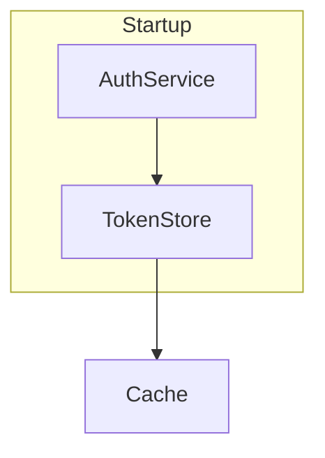

# `:::explorer` — syntax and rules

Pins a mermaid diagram beside its per-node detail sections. Clicking a box scrolls to that
box's section (both flash); clicking a section brings its box into view. Diagram *design*
(type, direction, color, legend) is in SKILL.md; this file is the block's grammar.

> The example is syntax only. Heading wording, section length and the kind of detail are the
> author's call — don't copy them as a convention.

````
## Login flow

:::explorer


### Startup {#boot}
Body for the subgraph.

### AuthService {#auth}
Any markdown: tables, code fences, lists, sub-headings, nested directives.

### TokenStore {#store}
Body.

### Cache {#cache}
Body.
:::
````

| Attr | Values | Default | Notes |
|------|--------|---------|-------|
| `pin` | `left`, `top` | `left` | `top` stacks the diagram above the detail at any width |
| `width` | CSS length (`%`, `px`, `rem`, `em`, `ch`, `vw`) | `45%` | diagram column; anything else falls back |

## Pairing — one rule

A heading carries a `{#id}` anchor naming the mermaid node's **own id**. The anchor is
stripped from the rendered heading, so box label and heading text can differ. Subgraphs pair
the same way.

```
flowchart TD     auth["AuthService"]    ↔   ### AuthService {#auth}
stateDiagram-v2  auth : AuthService     ↔   ### AuthService {#auth}
classDiagram     class auth["Auth"]     ↔   ### Auth {#auth}
subgraph         subgraph boot["Boot"]  ↔   ### Boot {#boot}
```

Linked boxes get a dot, so an *unmarked* box means "nothing more to read". Every failure
below is silent — the box just goes dead:

| Mistake | Result |
|---------|--------|
| Heading has no `{#id}` | box never linked |
| `{#id}` matches no node id | nothing pairs |
| `{#id}` not the **last** thing in the heading (`### {#a} Cache`) | rendered as literal text |
| Section heading wrapped in a nested directive (`:::card`) | drops out of the pairing — keep them top-level in the block |
| Pairing by number or label instead of node id | nothing pairs |

## Structure

- **Splitting** — the *first* `mermaid` fence pins, with anything above it; everything after
  becomes the detail pane (including a closing callout listing what the diagram hides). Later mermaid fences are
  ordinary diagrams in the pane. To give the pinned diagram a color key, wrap its fence in
  `:::legend` (see SKILL.md §4) — the whole legend block pins.
- **Titling** — the block has no title. Put a heading immediately *before* it, one level above
  the section headings inside (`##` outside, `###` inside). A heading *inside* the block lands
  in the detail column and labels only half the view.
- **Content** — the detail pane is a full document; each section is as long as the subject
  needs.

## Layout and design

- `pin=left` is a narrow column (needs a tall shape, so `TD` chains); `pin=top` is wide
  (needs a short one). Narrow screens stack with the diagram sticky; a stacked diagram over 60%
  of viewport height doesn't pin.
- Cap ~10-12 nodes: each needs a detail section. Over that, split into parent + detail
  diagrams at a subsystem boundary, title each after the node it expands, and end the parent's
  pane with a callout listing what it hides.

## Limits

- **Linking works for `flowchart`/`graph`, `stateDiagram-v2`, `classDiagram` only.** Other
  types pin and render but never link; `{#id}` anchors there are harmless but dead.

  | Type | Why not |
  |------|---------|
  | `erDiagram` | mermaid 11.15 rejects entity aliases (`auth["Auth"]` is a parse error), so a box can only show the raw id |
  | `sequenceDiagram`, `C4Context`, `timeline`, `journey`, `gitGraph`, `mindmap` | the author's id never reaches the SVG; elements are numbered by position (`actor0`, `node-0`), so a match would silently point at the wrong section after a reorder |
- Your own `classDef` colors always win over the renderer; use `var(--c-*)` tokens, never hex.
- **One diagram per `:::legend`**, same one-diagram assumption as the explorer.
